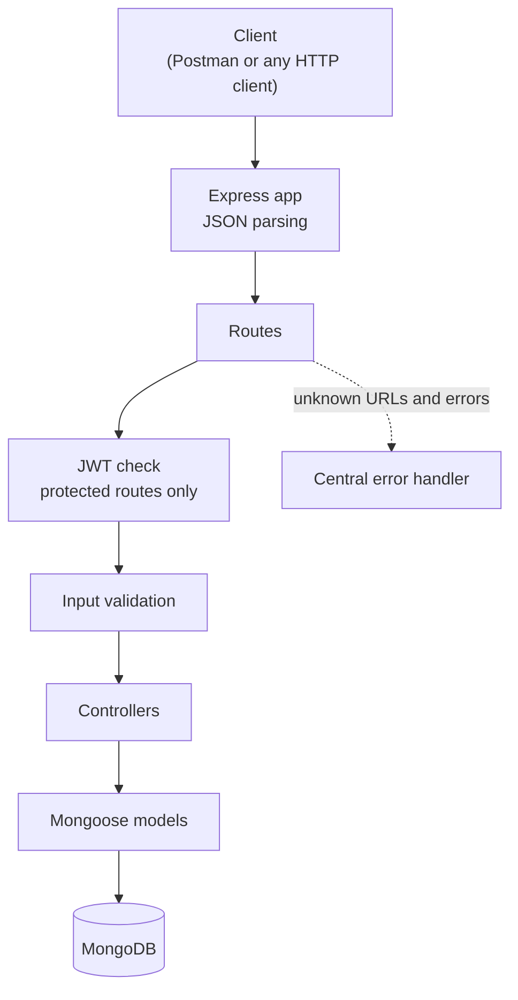
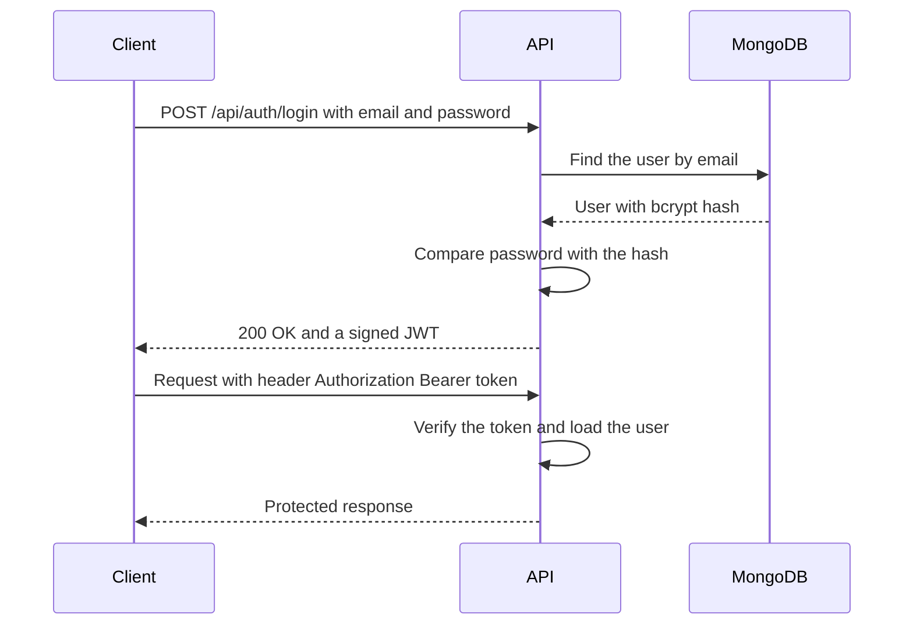
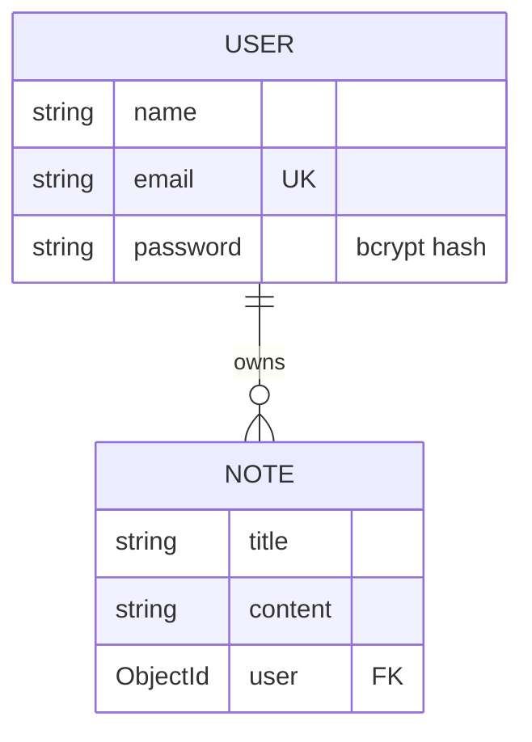

<div align="center">

# Skill Nexis Week 2: Backend Development (MERN)

**Three REST APIs built with Node.js, Express and MongoDB**

[](https://nodejs.org)
[](https://expressjs.com)
[](https://www.mongodb.com)
[](https://jwt.io)
[](https://www.npmjs.com/package/bcrypt)

</div>

Hi! This repository collects the three backend projects I built in **Week 2** of my **Skill Nexis Full Stack Web Development (MERN)** internship. The week covered Node.js and NPM, Express.js routing, MongoDB with Mongoose, REST API design, and authentication with JWT and bcrypt. I built one project for each of the two assignments, plus the mini project.

Each project is a standalone Express API in its own folder, with its own README, tests and setup steps. This page is the overview. I have tried to keep it honest: it says what each API does, what I tested, and what I have **not** yet been able to verify (the checks that need a live MongoDB database and Postman). See [Testing and verification](#testing-and-verification).

## Contents

1. [About this repository](#about-this-repository)
2. [The three projects at a glance](#the-three-projects-at-a-glance)
3. [How the projects map to the official assignments](#how-the-projects-map-to-the-official-assignments)
4. [Architecture](#architecture)
5. [Project 1: To-Do List REST API](#project-1-to-do-list-rest-api)
6. [Project 2: User Authentication API](#project-2-user-authentication-api)
7. [Project 3: Notes App Backend (Mini Project)](#project-3-notes-app-backend-mini-project)
8. [Technology stack](#technology-stack)
9. [Security and engineering practices](#security-and-engineering-practices)
10. [Testing and verification](#testing-and-verification)
11. [Getting started locally](#getting-started-locally)
12. [Repository structure](#repository-structure)
13. [What I learned](#what-i-learned)
14. [Acknowledgment](#acknowledgment)
15. [Closing note](#closing-note)

## About this repository

| | |
| --- | --- |
| **Internship** | Skill Nexis, Full Stack Web Development (MERN) |
| **Module** | Week 2: Backend Development (Node.js, Express.js, MongoDB) |
| **What is inside** | Three independent backend projects |
| **Frontend?** | None. Week 2 is backend only. |
| **Deployment** | None. The APIs are meant to be run locally. |

The official Week 2 material also includes a React practice set. It belongs to a different topic, so it is not part of this repository.

## The three projects at a glance

| Project | What it is | Built with | Highlights |
| --- | --- | --- | --- |
| **[1. To-Do List REST API](todo-list-api/README.md)** | Backend for a task list | Express, Mongoose | Create, list, fetch, update and delete tasks. Input validation |
| **[2. User Authentication API](user-auth-api/README.md)** | Registration and login | Express, Mongoose, bcrypt, JWT | Hashed passwords, token on login, one protected route |
| **[3. Notes App Backend](notes-app-backend/README.md)** | Private notes per user | Express, Mongoose, bcrypt, JWT | Notes CRUD behind a JWT check. Users only see their own notes |

All three use Node.js and store data in MongoDB through Mongoose. Only projects 2 and 3 use bcrypt and JWT.

## How the projects map to the official assignments

The official Week 2 material is short, so I separate what it asks for from the choices I made myself.

| Official item | Folder | What the material asks for | What I added on top |
| --- | --- | --- | --- |
| Assignment 1: To-Do List REST API | `todo-list-api` | Endpoints to add, update and delete tasks. MongoDB storage. Postman for testing | Endpoints to list and fetch tasks, `PATCH` alongside `PUT`, validation, a Postman checklist |
| Assignment 2: User Authentication API | `user-auth-api` | Registration and login routes. Password encryption. JWT-based authentication | `GET /api/auth/profile`, a small protected route so the JWT can actually be demonstrated |
| Mini Project: Notes App Backend | `notes-app-backend` | A backend API for notes with CRUD operations. Routes secured with JWT | Register and login routes (to obtain a token), per-user note ownership, the note fields |

A note on wording: the material says "password encryption". I implemented it with **bcrypt hashing**, which is a one-way hash rather than reversible encryption. That is the standard way to store passwords.

## Architecture

Each API follows the same layered structure. A request passes through routing, optional JWT and validation steps, a controller, and a Mongoose model before it reaches MongoDB. Project 1 has no JWT step. In project 2 only `GET /api/auth/profile` uses it.



The login flow in projects 2 and 3 works like this:



## Project 1: To-Do List REST API

**Folder:** [`todo-list-api/`](todo-list-api/) · **Details:** [`todo-list-api/README.md`](todo-list-api/README.md)

**Objective.** Build a REST API that stores tasks in MongoDB and lets a client add, read, update and delete them.

**Real-world problem.** Any task-tracking app needs a backend that remembers tasks and lets the client create, complete, edit and remove them.

**Built with:** Node.js, Express.js, MongoDB, Mongoose, dotenv (nodemon for development). It has no authentication, which is intentional: that belongs to Assignment 2.

**Features**

- Create, list, fetch, update and delete tasks
- Mongoose `Todo` schema: `title` (required, up to 100 characters), `description` (optional, up to 500), `completed` (defaults to `false`), plus automatic timestamps
- Update with `PUT` or `PATCH`: send only the fields you want to change
- Validation of field types and lengths, and of the ID format
- Consistent JSON responses with 200, 201, 400, 404 and 500 status codes

**Endpoints**

| Method | Endpoint | Purpose | Access |
| --- | --- | --- | --- |
| GET | `/` | Check that the API is running | Public |
| POST | `/api/todos` | Create a task | Public |
| GET | `/api/todos` | List all tasks, newest first | Public |
| GET | `/api/todos/:id` | Fetch one task | Public |
| PUT / PATCH | `/api/todos/:id` | Update a task | Public |
| DELETE | `/api/todos/:id` | Delete a task | Public |

<details>
<summary><b>Example request and response</b></summary>

`POST /api/todos`

```json
{ "title": "Learn Express.js", "description": "Finish the routing chapter" }
```

Response, `201 Created` (the id and dates are examples):

```json
{
  "success": true,
  "message": "Todo created successfully",
  "data": {
    "_id": "665f1c2e8a1b2c3d4e5f6a7b",
    "title": "Learn Express.js",
    "description": "Finish the routing chapter",
    "completed": false,
    "createdAt": "2026-10-02T10:00:00.000Z",
    "updatedAt": "2026-10-02T10:00:00.000Z"
  }
}
```

An empty body returns `400` with `{ "success": false, "message": "Validation failed", "errors": ["Title is required"] }`.

</details>

**Environment variables:** `PORT`, `MONGODB_URI`, `NODE_ENV` (see [`.env.example`](todo-list-api/.env.example)).

**Testing.** 25 offline tests pass: 20 for validation and error handling, and 5 for the controller logic using an in-memory stand-in for the database. A 14-check smoke script and a Postman checklist are included; they need a running server and MongoDB and have **not been run yet**.

## Project 2: User Authentication API

**Folder:** [`user-auth-api/`](user-auth-api/) · **Details:** [`user-auth-api/README.md`](user-auth-api/README.md)

**Objective.** Let people register and log in, keep their passwords safe with bcrypt, and issue a JWT when they log in.

**Real-world problem.** Most apps have accounts. Passwords must never be stored in plain text, and the server needs a safe way to recognise a returning user without asking for the password on every request.

**Built with:** Node.js, Express.js, MongoDB, Mongoose, **bcrypt**, **jsonwebtoken**, dotenv (nodemon for development).

**Features**

- Registration with name, email and password
- Login that returns a signed JWT (lifetime set by `JWT_EXPIRES_IN`, default 1 day)
- Passwords hashed with bcrypt (10 salt rounds). Only the hash is stored and it is never returned
- Unique, lowercase email, with a clear `409` for duplicates
- `GET /api/auth/profile`, a protected route. **This is my addition, not part of the official requirements.** It exists so the JWT check can be demonstrated

**Endpoints**

| Method | Endpoint | Purpose | Access |
| --- | --- | --- | --- |
| GET | `/` | Check that the API is running | Public |
| POST | `/api/auth/register` | Register a new user | Public |
| POST | `/api/auth/login` | Log in and receive a JWT | Public |
| GET | `/api/auth/profile` | Return the logged-in user (my addition) | 🔒 Bearer token |

**Security and validation**

- A wrong password and an unknown email return the same `401` message, so the API does not reveal which emails are registered
- The JWT secret comes from `JWT_SECRET`. The server refuses to start if it is missing, shorter than 16 characters, or still the placeholder from `.env.example`
- The protected route rejects a missing, malformed, wrongly signed or expired token, and a token for a user that no longer exists
- Name, email and password must be strings of a sensible length, so object payloads such as `{"$gt": ""}` are rejected before reaching the database

<details>
<summary><b>Example requests</b></summary>

`POST /api/auth/register`

```json
{ "name": "Alice Johnson", "email": "alice@example.com", "password": "secret123" }
```

`201 Created`: returns the new user's `id`, `name`, `email` and `createdAt`, and **never** the password.

`POST /api/auth/login`

```json
{ "email": "alice@example.com", "password": "secret123" }
```

`200 OK`: returns `"message": "Login successful"`, a `token`, and the user. Then call the protected route:

```http
GET /api/auth/profile
Authorization: Bearer <paste the token here>
```

</details>

**Environment variables:** `PORT`, `MONGODB_URI`, `JWT_SECRET`, `JWT_EXPIRES_IN`, `NODE_ENV` (see [`.env.example`](user-auth-api/.env.example)).

**Testing.** 54 offline tests pass: 33 for validation, input attacks, the JWT-secret check and error handling, and 21 for registration, login and token logic using stand-ins for MongoDB, bcrypt and jsonwebtoken. The tests were also run against deliberately broken copies of the code to confirm they notice real mistakes. A 21-check smoke script and a Postman checklist are included but have **not been run yet**.

## Project 3: Notes App Backend (Mini Project)

**Folder:** [`notes-app-backend/`](notes-app-backend/) · **Details:** [`notes-app-backend/README.md`](notes-app-backend/README.md)

**Objective.** A backend for a notes app with full CRUD operations, where every note route is secured with JWT authentication.

**Real-world problem.** A notes app is only useful if each person's notes stay private. This project combines CRUD, authentication and ownership.

**Built with:** Node.js, Express.js, MongoDB, Mongoose, **bcrypt**, **jsonwebtoken**, dotenv (nodemon for development).

**Features**

- Create, list, fetch, update and delete notes. Every note route needs a valid JWT
- Notes belong to the user who created them. All queries are filtered by the logged-in user, and the owner always comes from the token, never from the request body
- Another user's note returns `404`, exactly like a note that does not exist
- Register and login routes so users can get a token. **These are my design decision**, because the material does not say how a user obtains one
- Note fields: `title` (required, up to 100 characters) and `content` (optional, up to 5000)



**Endpoints**

| Method | Endpoint | Purpose | Access |
| --- | --- | --- | --- |
| GET | `/` | Check that the API is running | Public |
| POST | `/api/auth/register` | Register a user (my design decision) | Public |
| POST | `/api/auth/login` | Log in and receive a JWT (my design decision) | Public |
| POST | `/api/notes` | Create a note | 🔒 Bearer token |
| GET | `/api/notes` | List my notes, newest first | 🔒 Bearer token |
| GET | `/api/notes/:id` | Fetch one of my notes | 🔒 Bearer token |
| PUT | `/api/notes/:id` | Update one of my notes | 🔒 Bearer token |
| DELETE | `/api/notes/:id` | Delete one of my notes | 🔒 Bearer token |

<details>
<summary><b>Example requests and errors</b></summary>

`POST /api/notes` with the header `Authorization: Bearer <token>`

```json
{ "title": "Shopping list", "content": "Milk, eggs, bread" }
```

`201 Created`: returns the note's `id`, `title`, `content` and timestamps. The owner id is not included.

Without a token, any note route returns `401`:

```json
{ "success": false, "message": "Not authorized: token missing" }
```

A note that does not exist, or belongs to someone else, returns `404`:

```json
{ "success": false, "message": "Note not found" }
```

</details>

**Environment variables:** `PORT`, `MONGODB_URI`, `JWT_SECRET`, `JWT_EXPIRES_IN`, `NODE_ENV` (see [`.env.example`](notes-app-backend/.env.example)).

**Testing.** 76 offline tests pass:

- 31 for validation, input attacks, the JWT-secret check and error handling
- 19 for registration, login and token logic
- 17 for note CRUD and "users only reach their own notes"
- 9 that use a stand-in Express to check that the JWT check sits in front of every note route

30 deliberate mistakes were also put into copies of the code (for example, removing the owner filter or the JWT check), and the tests caught all 30. A 38-check smoke script, which uses two users to prove one cannot touch the other's notes, and a 30-step Postman checklist are included but have **not been run yet**.

## Technology stack

| Technology | Role | P1 | P2 | P3 |
| --- | --- | :-: | :-: | :-: |
| Node.js (18 or newer) | Runs JavaScript on the server | ✅ | ✅ | ✅ |
| Express.js 4 | Web framework: routes, middleware, JSON handling | ✅ | ✅ | ✅ |
| MongoDB | Database that stores the data | ✅ | ✅ | ✅ |
| Mongoose 8 | Schemas, validation and queries for MongoDB | ✅ | ✅ | ✅ |
| dotenv | Loads settings from a `.env` file | ✅ | ✅ | ✅ |
| bcrypt | Hashes passwords before they are saved | | ✅ | ✅ |
| jsonwebtoken | Creates and verifies JWTs | | ✅ | ✅ |
| nodemon (dev only) | Restarts the server when files change | ✅ | ✅ | ✅ |
| Node's built-in test runner | Runs the offline tests | ✅ | ✅ | ✅ |

The versions above are the ranges declared in each `package.json`. Postman is the testing tool the assignments name. Each project includes a Postman checklist, but the checklists have not been run yet.

## Security and engineering practices

| Practice | P1 | P2 | P3 |
| --- | :-: | :-: | :-: |
| Input validation with type and length checks | ✅ | ✅ | ✅ |
| Central error handling with JSON error responses | ✅ | ✅ | ✅ |
| Error details hidden when `NODE_ENV=production` | ✅ | ✅ | ✅ |
| Settings in environment variables, `.env` git-ignored, placeholders in `.env.example` | ✅ | ✅ | ✅ |
| bcrypt password hashing, hash never returned | | ✅ | ✅ |
| JWT authentication with the secret from the environment | | ✅ | ✅ |
| Startup refusal of a missing, placeholder or too-short JWT secret | | ✅ | ✅ |
| Same error for unknown email and wrong password | | ✅ | ✅ |
| Duplicate emails handled (`409`, plus a unique index in the schema) | | ✅ | ✅ |
| Protected routes | | 1 route | all notes routes |
| Per-user note ownership | | | ✅ |

These are measures that exist in the code and are covered by the offline tests. They do not make the APIs production-ready. For example, there is no rate limiting, account lockout, refresh-token handling or password reset, and nothing has been deployed or load-tested. Treat them as well-structured learning projects.

## Testing and verification

I want to be clear about what has and has not been checked.

**Done: offline tests.** Each project's tests run with Node's built-in test runner (`npm test`) and need no database. They use small in-memory stand-ins for MongoDB, and in projects 2 and 3 for bcrypt and jsonwebtoken (and, for the route-wiring tests in project 3, for Express itself). That means they verify **my own logic**: validation rules, status codes, "the password is never returned", "only the hash is stored", and "the JWT check is in front of every note route". They do not verify the real libraries.

| Project | Offline tests | Test files | Deliberate-mistake check | Smoke script (not run yet) |
| --- | :-: | --- | --- | :-: |
| 1. To-Do List | **25** | 2 | not performed | 14 checks |
| 2. User Authentication | **54** | 2 | performed | 21 checks |
| 3. Notes App | **76** | 4 | **30 of 30** caught | 38 checks |

**Still to do: real-environment verification.** These could not be run in the offline environment where the projects were built and tested, so I am not claiming them:

- [ ] `npm install` (including the native `bcrypt` package)
- [ ] Starting each server and connecting to a real MongoDB
- [ ] Real HTTP requests handled by Express and real Mongoose queries
- [ ] Real bcrypt hashing and real JWT signing and verification
- [ ] The Postman checklists in each project README
- [ ] `npm run smoke-test` for each project

Until those boxes are ticked, these projects are tested offline but not yet runtime-tested end to end. This section should be updated once they have been run.

## Getting started locally

**You will need:** Node.js 18 or newer, a MongoDB database (a local MongoDB or a free MongoDB Atlas cluster), and optionally Postman.

Every project starts the same way. Replace `<folder>` with `todo-list-api`, `user-auth-api` or `notes-app-backend`:

```bash
cd <folder>
npm install
cp .env.example .env      # Windows (Command Prompt): copy .env.example .env
# edit .env: set MONGODB_URI (and JWT_SECRET for projects 2 and 3)
npm run dev               # or: npm start
npm test                  # offline tests, no database needed
```

For projects 2 and 3, generate a strong `JWT_SECRET` with:

```bash
node -e "console.log(require('crypto').randomBytes(32).toString('hex'))"
```

All three APIs listen on port `5000` by default, so run one at a time or give each its own `PORT` in `.env`. When the server is running, `npm run smoke-test` in a second terminal checks every route against your database.

<details>
<summary><b>Environment variables per project</b></summary>

| Variable | P1 | P2 | P3 | Purpose |
| --- | :-: | :-: | :-: | --- |
| `PORT` | ✅ | ✅ | ✅ | Port the server listens on (default `5000`) |
| `MONGODB_URI` | ✅ | ✅ | ✅ | Your MongoDB connection string |
| `JWT_SECRET` | | ✅ | ✅ | Secret used to sign tokens (at least 16 characters) |
| `JWT_EXPIRES_IN` | | ✅ | ✅ | Token lifetime, for example `1d` |
| `NODE_ENV` | ✅ | ✅ | ✅ | `development` shows error details, `production` hides them |

Only placeholder values are committed. Never commit your real `.env`.

</details>

## Repository structure

The repository holds the three projects side by side. Each folder is the unpacked content of the matching Skill Nexis submission archive. `node_modules` and `.env` are deliberately not included.

```text
.
├── README.md
├── todo-list-api/        # Project 1: To-Do List REST API
├── user-auth-api/        # Project 2: User Authentication API
└── notes-app-backend/    # Project 3: Notes App Backend (Mini Project)
```

<details>
<summary><b>Full file listing: todo-list-api (16 files)</b></summary>

```text
todo-list-api/
├── scripts/
│   └── smokeCheck.js             # end-to-end check for a running server + MongoDB
├── src/
│   ├── config/
│   │   └── db.js                     # MongoDB connection
│   ├── controllers/
│   │   └── todoController.js         # task CRUD logic
│   ├── middleware/
│   │   ├── asyncHandler.js           # forwards async errors
│   │   ├── errorHandler.js           # 404 + central error handler
│   │   └── validateTodo.js           # task input validation
│   ├── models/
│   │   └── Todo.js                   # task schema
│   ├── routes/
│   │   └── todoRoutes.js             # task routes
│   └── app.js                    # Express setup
├── tests/
│   ├── controller.logic.test.js  # offline: controller logic (in-memory fake)
│   └── validation.test.js        # offline: validation + error handling
├── .env.example              # placeholder variable names only
├── .gitignore                # keeps .env and node_modules out of Git
├── README.md                 # project documentation
├── package.json              # dependencies and npm scripts
└── server.js                 # entry point
```

</details>

<details>
<summary><b>Full file listing: user-auth-api (19 files)</b></summary>

```text
user-auth-api/
├── scripts/
│   └── smokeCheck.js             # end-to-end check for a running server + MongoDB
├── src/
│   ├── config/
│   │   ├── checkEnv.js               # JWT_SECRET safety check
│   │   └── db.js                     # MongoDB connection
│   ├── controllers/
│   │   └── authController.js         # register / login logic
│   ├── middleware/
│   │   ├── asyncHandler.js           # forwards async errors
│   │   ├── authMiddleware.js         # JWT check ("protect")
│   │   ├── errorHandler.js           # 404 + central error handler
│   │   └── validateAuth.js           # register / login input validation
│   ├── models/
│   │   └── User.js                   # user schema
│   ├── routes/
│   │   └── authRoutes.js             # auth routes
│   ├── utils/
│   │   └── generateToken.js          # signs the JWT
│   └── app.js                    # Express setup
├── tests/
│   ├── auth.logic.test.js        # offline: auth logic (fakes)
│   └── validation.test.js        # offline: validation + error handling
├── .env.example              # placeholder variable names only
├── .gitignore                # keeps .env and node_modules out of Git
├── README.md                 # project documentation
├── package.json              # dependencies and npm scripts
└── server.js                 # entry point
```

</details>

<details>
<summary><b>Full file listing: notes-app-backend (25 files)</b></summary>

```text
notes-app-backend/
├── scripts/
│   └── smokeCheck.js             # end-to-end check for a running server + MongoDB
├── src/
│   ├── config/
│   │   ├── checkEnv.js               # JWT_SECRET safety check
│   │   └── db.js                     # MongoDB connection
│   ├── controllers/
│   │   ├── authController.js         # register / login logic
│   │   └── noteController.js         # note CRUD logic (own notes only)
│   ├── middleware/
│   │   ├── asyncHandler.js           # forwards async errors
│   │   ├── authMiddleware.js         # JWT check ("protect")
│   │   ├── errorHandler.js           # 404 + central error handler
│   │   ├── validateAuth.js           # register / login input validation
│   │   └── validateNote.js           # note input + ID validation
│   ├── models/
│   │   ├── Note.js                   # note schema
│   │   └── User.js                   # user schema
│   ├── routes/
│   │   ├── authRoutes.js             # auth routes
│   │   └── noteRoutes.js             # note routes behind the JWT check
│   ├── utils/
│   │   └── generateToken.js          # signs the JWT
│   └── app.js                    # Express setup
├── tests/
│   ├── auth.logic.test.js        # offline: auth logic (fakes)
│   ├── notes.logic.test.js       # offline: note CRUD + ownership (fakes)
│   ├── routes.wiring.test.js     # offline: route wiring (fake Express)
│   └── validation.test.js        # offline: validation + error handling
├── .env.example              # placeholder variable names only
├── .gitignore                # keeps .env and node_modules out of Git
├── README.md                 # project documentation
├── package.json              # dependencies and npm scripts
└── server.js                 # entry point
```

</details>

## What I learned

- **REST API design.** Using resource-based URLs, the right HTTP methods and meaningful status codes, and keeping responses consistent
- **Express structure.** Splitting an app into routes, controllers, middleware and configuration so each file has one job
- **MongoDB with Mongoose.** Defining schemas, setting rules such as required fields, length limits and unique values, and relating notes to the users who own them
- **Authentication.** Hashing passwords with bcrypt, issuing and verifying JWTs, and protecting routes with middleware
- **Authorization.** Authentication only proves who someone is. Making sure a user can reach only their own notes is a separate piece of work
- **Validation and error handling.** Checking input early, rejecting unexpected data types, and returning clear errors without leaking internal details
- **Configuration and secrets.** Keeping secrets in environment variables and making the server refuse to start with an unsafe JWT secret
- **Testing and honest reporting.** Writing tests that run without a database, checking them against deliberately broken code, and being clear about what has and has not been verified

## Acknowledgment

These projects were completed for the **Skill Nexis Full Stack Web Development (MERN) internship**, **Week 2: Backend Development (Node.js, Express.js, MongoDB)**. The assignment titles, topics and requirements come from the official Week 2 material provided by Skill Nexis. Thank you to Skill Nexis for the structured, hands-on introduction to backend development.

## Closing note

Week 2 gave me hands-on practice with three backend API designs, including authentication, ownership rules and tests. The next step is to run everything against a live database and Postman and update the verification checklist above. If you are reading this as a reviewer, the individual project READMEs have the full setup steps, endpoint details and Postman checklists. Thanks for taking a look.
